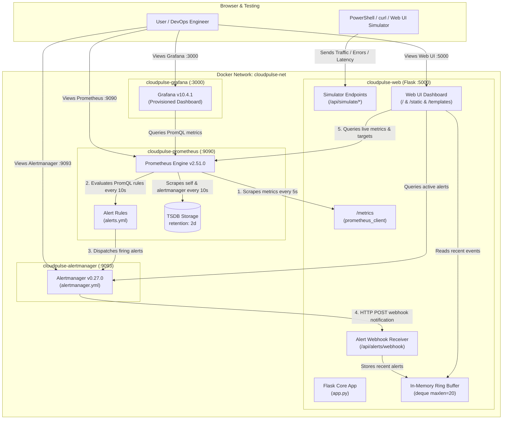

# CloudPulse — DevOps Monitoring & Alerting Platform

[](https://docs.docker.com/compose/)
[](https://flask.palletsprojects.com/)
[](https://prometheus.io/)
[](https://prometheus.io/docs/alerting/latest/alertmanager/)
[](https://grafana.com/)

A production-style, containerized DevOps monitoring and alerting stack designed to observe application availability, request throughput, HTTP error rates, and p95 latency in real time. 

Built with **Python Flask**, **Prometheus**, **Alertmanager**, and **Grafana**, this project demonstrates end-to-end Site Reliability Engineering (SRE) and DevOps workflows: from instrumenting custom application metrics using `prometheus_client` to defining declarative PromQL alert rules, routing automated alerts through Alertmanager webhooks, and visualizing live telemetry via pre-provisioned Grafana dashboards.

---

## Table of Contents

- [Overview](#overview)
- [Key Features](#key-features)
- [Technology Stack](#technology-stack)
- [System Architecture & Data Flow](#system-architecture--data-flow)
- [Project Directory Structure](#project-directory-structure)
- [Prerequisites](#prerequisites)
- [Installation & Quick Start](#installation--quick-start)
- [Service URLs & Default Credentials](#service-urls--default-credentials)
- [Monitoring & Alert Rules](#monitoring--alert-rules)
- [Testing & Alert Verification](#testing--alert-verification)
- [Grafana Dashboard](#grafana-dashboard)
- [Troubleshooting Guide](#troubleshooting-guide)
- [Security & Limitations](#security--limitations)
- [Future Improvements](#future-improvements)
- [Author & Portfolio Summary](#author--portfolio-summary)

---

## Overview

Modern cloud-native systems require continuous visibility into performance and failure modes. **CloudPulse** provides an all-in-one local observability platform that simulates real-world production monitoring:

1. **Application Instrumentation:** A Python Flask web service exposes custom RED (Rate, Errors, Duration) metrics at `/metrics`.
2. **Time-Series Metric Scraping:** Prometheus scrapes application metrics every 5 seconds and system targets every 10 seconds.
3. **Automated Alert Evaluation:** Declarative PromQL rules continuously monitor service uptime, HTTP 5xx error spikes, and p95 response latencies.
4. **Alert Routing & Webhook Ingestion:** Firing alerts are dispatched to Alertmanager, which deduplicates and routes notifications back to a custom webhook receiver in the CloudPulse dashboard.
5. **Interactive Telemetry:** Both a built-in dark-navy web UI and a fully provisioned Grafana dashboard present real-time telemetry and target health.
6. **Scenario Testing:** Integrated simulator endpoints allow engineers to generate synthetic normal traffic, trigger 500 errors, and induce latency spikes to observe alert state transitions (`Inactive` → `Pending` → `Firing` → `Resolved`).

---

## Key Features

- **Containerized Micro-Architecture:** Complete stack packaged into 4 Docker containers coordinated by Docker Compose on an isolated bridge network (`cloudpulse-net`).
- **Standard Prometheus Instrumentation:** Implements `flask_http_request_total` (Counter), `flask_http_request_duration_seconds` (Histogram with custom latency buckets), and `flask_active_requests` (Gauge) via `prometheus_client`.
- **Automated Service Discovery & Health:** Prometheus monitors the availability of all core infrastructure targets (`cloudpulse-app`, `prometheus`, `alertmanager`).
- **Declarative Prometheus Alert Rules:**
  - `ServiceDown`: Critical alert triggered when any monitored instance is unreachable for > 20s (`up == 0`).
  - `HighHttpErrorRate`: Warning alert triggered when HTTP 5xx errors exceed 10% of total traffic over a 1-minute window for > 30s.
  - `HighRequestLatency`: Warning alert triggered when 95th-percentile response latency on slow endpoints exceeds 1.0 second for > 30s.
- **Alertmanager Webhook Integration:** Alertmanager dispatches firing and resolved events to `/api/alerts/webhook`, populating an in-memory ring buffer (`deque(maxlen=20)`) rendered directly on the web interface.
- **Built-in Interactive Web Console:**
  - Real-time status indicators for Prometheus and Alertmanager connectivity.
  - Live target health inspection table with scrape durations and timestamps.
  - PromQL-driven summary cards for cumulative requests, request rate, 5xx error percentage, and p95 latency.
  - On-page simulator buttons to fire instant batches of test requests.
- **Auto-Provisioned Grafana Visualizations:** Out-of-the-box provisioning for the Prometheus datasource and the pre-built `CloudPulse Monitoring` dashboard (7 specialized metric panels).

---

## Technology Stack

| Technology | Role in CloudPulse | Verified Configuration |
|---|---|---|
| **Python 3.11 / Flask** | Core web service, metrics exporter, dashboard backend, and webhook receiver. | `Flask>=3.0.0`, `requests>=2.31.0` |
| **prometheus-client** | Python SDK for instrumenting Counters, Histograms, and Gauges. | `prometheus-client>=0.20.0` |
| **Docker & Docker Compose** | Container image builds, multi-container lifecycle management, and network isolation. | Docker Compose v2, Python 3.11-slim base |
| **Prometheus** | Time-series database, pull-based metric scraper, and PromQL alerting engine. | `prom/prometheus:v2.51.0` |
| **Alertmanager** | Alert grouping, deduplication, throttling, and webhook routing. | `prom/alertmanager:v0.27.0` |
| **Grafana** | Centralized dashboard visualization and time-series graphing. | `grafana/grafana:10.4.1` |
| **PromQL** | Declarative query language for metric aggregations and alert thresholds. | Native Prometheus query engine |
| **HTML5 / CSS3 / JavaScript** | Responsive web console with live async polling (5s interval) and dark-mode styling. | Native vanilla ES6+ & CSS variables |

---

## System Architecture & Data Flow



### Telemetry & Alert Lifecycle

1. **Instrumentation:** HTTP requests hitting `app.py` update metrics (`flask_http_request_total`, `flask_http_request_duration_seconds`, `flask_active_requests`).
2. **Collection:** Prometheus scrapes `http://web:5000/metrics` every 5 seconds and records samples into TSDB.
3. **Evaluation:** Prometheus evaluates alert rules in `alerts.yml` every 10 seconds. When an anomaly violates a threshold for the configured duration (20s–30s), the alert transitions from `Inactive` to `Pending`, then to `Firing`.
4. **Dispatch:** Prometheus forwards the firing alert to `http://alertmanager:9093`.
5. **Notification:** Alertmanager groups the alert and dispatches an HTTP POST payload to the CloudPulse webhook endpoint `http://web:5000/api/alerts/webhook`.
6. **Visualization:** The CloudPulse web UI pulls live metrics and targets via `/api/dashboard-data` every 5 seconds, while Grafana renders rich time-series graphs via its pre-configured Prometheus datasource.

> [!NOTE]
> Alertmanager is configured exclusively with an internal HTTP webhook receiver (`cloudpulse-dashboard`). It does not send external Slack, Discord, PagerDuty, or SMTP email alerts.

---

## Project Directory Structure

```text
CloudPulse/
│
├── app.py                                # Flask backend, Prometheus metrics exporter, webhook receiver
├── Dockerfile                            # Multi-stage Python 3.11-slim container definition
├── docker-compose.yml                    # Docker Compose stack (web, prometheus, alertmanager, grafana)
├── requirements.txt                      # Python dependencies (Flask, prometheus-client, requests)
├── README.md                             # Comprehensive project documentation
├── .gitignore                            # Git exclusions for Python cache, bytecode, and IDE artifacts
│
├── alertmanager/
│   └── alertmanager.yml                  # Alertmanager routing and webhook configuration
│
├── prometheus/
│   ├── prometheus.yml                    # Scrape jobs, scrape intervals, and Alertmanager linkage
│   └── alerts.yml                        # PromQL alerting rules (ServiceDown, HighHttpErrorRate, HighRequestLatency)
│
├── grafana/
│   └── provisioning/
│       ├── datasources/
│       │   └── prometheus.yml            # Automated Prometheus datasource registration
│       └── dashboards/
│           ├── dashboards.yml            # Automated dashboard provider definition
│           └── cloudpulse-monitoring.json # Pre-built 7-panel monitoring dashboard
│
├── templates/
│   └── index.html                        # Semantic HTML5 dashboard template
│
└── static/
    ├── style.css                         # Dark navy responsive UI stylesheet
    └── app.js                            # Client-side controller (5s async polling, simulator handlers)
```

---

## Prerequisites

Before starting the platform, ensure the following tools are installed on your host system:

| Prerequisite | Minimum Version | Verification Command | Notes |
|---|---|---|---|
| **Operating System** | Windows 10/11, macOS, or Linux | `[System.Environment]::OSVersion` | Requires WSL2 backend on Windows. |
| **Docker Desktop / Engine** | Docker Engine 20.10+ | `docker --version` | Ensure Docker Desktop is running. |
| **Docker Compose** | Compose v2.0+ | `docker compose version` | Built into modern Docker Desktop. |
| **Web Browser** | Modern release | N/A | Chrome, Edge, Firefox, or Brave. |
| **curl.exe / PowerShell** | PowerShell 5.1+ or 7+ | `curl.exe --version` | For generating synthetic test traffic. |

> [!TIP]
> The CloudPulse stack has a minimal resource footprint (typically consuming under 400 MB of total RAM), making it suitable for running on laptops with 8 GB of RAM.

---

## Installation & Quick Start

Follow these step-by-step instructions to launch the platform from PowerShell on Windows.

### 1. Open PowerShell and Navigate to the Project Directory

```powershell
cd C:\Users\manik\Downloads\CloudPulse
```

Verify that all required project files are present:

```powershell
Get-ChildItem
```

### 2. Build and Launch the Stack

Run Docker Compose in detached mode. This command builds the custom Flask image and pulls official images for Prometheus, Alertmanager, and Grafana:

```powershell
docker compose up -d --build
```

### 3. Verify Container Status

Confirm that all 4 containers are running:

```powershell
docker compose ps
```

**Expected output:**

```text
NAME                     IMAGE                       COMMAND                  SERVICE        CREATED          STATUS          PORTS
cloudpulse-alertmanager  prom/alertmanager:v0.27.0   "/bin/alertmanager -…"   alertmanager   10 seconds ago   Up 10 seconds   0.0.0.0:9093->9093/tcp
cloudpulse-grafana       grafana/grafana:10.4.1      "/run.sh"                grafana        10 seconds ago   Up 10 seconds   0.0.0.0:3000->3000/tcp
cloudpulse-prometheus    prom/prometheus:v2.51.0     "/bin/prometheus --c…"   prometheus     10 seconds ago   Up 10 seconds   0.0.0.0:9090->9090/tcp
cloudpulse-web           cloudpulse-web              "python app.py"          web            10 seconds ago   Up 10 seconds   0.0.0.0:5000->5000/tcp
```

### 4. Inspect Container Logs

To view streaming logs from all services simultaneously:

```powershell
docker compose logs -f
```

To tail logs for a specific service:

```powershell
# Flask application logs
docker compose logs -f web

# Prometheus scraper and rule evaluation logs
docker compose logs -f prometheus

# Alertmanager notification logs
docker compose logs -f alertmanager

# Grafana logs
docker compose logs -f grafana
```

### 5. Stopping and Tearing Down the Platform

To temporarily stop the containers without removing them:

```powershell
docker compose stop
```

To restart stopped containers:

```powershell
docker compose start
```

To stop and remove all containers, networks, and ephemeral volumes:

```powershell
docker compose down
```

---

## Service URLs & Default Credentials

Once the containers are up, access the individual services via your browser:

| Service | Local URL | Description | Default Credentials |
|---|---|---|---|
| **CloudPulse Web Dashboard** | [http://localhost:5000](http://localhost:5000) | Main monitoring UI with live metrics and simulator. | None (Public UI) |
| **Prometheus Metrics Scrape** | [http://localhost:5000/metrics](http://localhost:5000/metrics) | Raw Prometheus metrics exported by Flask. | None |
| **Prometheus Web UI** | [http://localhost:9090](http://localhost:9090) | PromQL query console and TSDB status. | None |
| **Prometheus Targets** | [http://localhost:9090/targets](http://localhost:9090/targets) | Live health status of all scrape endpoints. | None |
| **Prometheus Alerts** | [http://localhost:9090/alerts](http://localhost:9090/alerts) | Real-time state of configured alerting rules. | None |
| **Alertmanager UI** | [http://localhost:9093](http://localhost:9093) | Active alert groups, silences, and routes. | None |
| **Grafana Dashboard** | [http://localhost:3000](http://localhost:3000) | Pre-provisioned telemetry dashboards. | `admin` / `admin` |

### Grafana Credential Management

Grafana credentials are configured in [docker-compose.yml](file:///C:/Users/manik/Downloads/CloudPulse/docker-compose.yml#L52-L55) via environment variables:

```yaml
environment:
  - GF_SECURITY_ADMIN_USER=admin
  - GF_SECURITY_ADMIN_PASSWORD=admin
  - GF_USERS_ALLOW_SIGN_UP=false
```

> [!WARNING]
> For production environments, never commit plaintext credentials. Use environment files (`.env`), Docker secrets, or external secret managers to inject `GF_SECURITY_ADMIN_PASSWORD`.

---

## Monitoring & Alert Rules

Prometheus evaluates 3 production-grade alerting rules defined in [prometheus/alerts.yml](file:///C:/Users/manik/Downloads/CloudPulse/prometheus/alerts.yml).

### 1. `ServiceDown`

- **Purpose:** Detects when an instrumented target goes offline or stops responding to Prometheus scrape attempts.
- **Exact PromQL Expression:**
  ```promql
  up == 0
  ```
- **Threshold:** Value equals `0` (unreachable).
- **Duration (`for`):** `20s` (must fail consecutive scrapes across 20 seconds).
- **Severity:** `critical`
- **Annotations:**
  - *Summary:* `Instance {{ $labels.instance }} is down`
  - *Description:* `Target {{ $labels.instance }} in job {{ $labels.job }} has been unreachable for more than 20 seconds.`
- **Verification:**
  1. Stop the web container: `docker stop cloudpulse-web`
  2. Open [http://localhost:9090/alerts](http://localhost:9090/alerts).
  3. Within 10 seconds, `ServiceDown` transitions to **Pending**.
  4. After 20 seconds, it transitions to **Firing** and routes to Alertmanager.
  5. Restart the container: `docker start cloudpulse-web`. The alert resolves automatically.

---

### 2. `HighHttpErrorRate`

- **Purpose:** Identifies sudden spikes in internal server errors (HTTP 5xx responses) affecting end users.
- **Exact PromQL Expression:**
  ```promql
  (sum by (job) (rate(flask_http_request_total{status=~"5.."}[1m])) / sum by (job) (rate(flask_http_request_total[1m]))) * 100 > 10
  ```
- **Threshold:** HTTP 5xx error percentage exceeds `10%` of total request traffic.
- **Duration (`for`):** `30s` (sustained condition over a 1-minute rate calculation for at least 30 seconds).
- **Severity:** `warning`
- **Annotations:**
  - *Summary:* `High HTTP 5xx error rate detected`
  - *Description:* `HTTP 5xx error rate on {{ $labels.job }} is above 10% over the last minute.`
- **Verification:**
  1. Send a burst of 500 errors using curl or the web simulator.
  2. The calculated error rate on [http://localhost:5000](http://localhost:5000) and Grafana jumps to 100%.
  3. At 30s, the rule enters **Firing** status in Prometheus and appears in the Alertmanager notification stream.

---

### 3. `HighRequestLatency`

- **Purpose:** Detects performance degradation where the 95th percentile (p95) response time on slow application paths exceeds acceptable SLAs.
- **Exact PromQL Expression:**
  ```promql
  histogram_quantile(0.95, sum by (le, job) (rate(flask_http_request_duration_seconds_bucket{endpoint="simulate_slow"}[1m]))) > 1.0
  ```
- **Filter Notice:** The rule specifically filters for `{endpoint="simulate_slow"}` to isolate deliberate high-latency endpoints from fast health-check traffic.
- **Threshold:** 95th-percentile response time exceeds `1.0s`.
- **Duration (`for`):** `30s` (sustained over a 1-minute rate calculation).
- **Severity:** `warning`
- **Annotations:**
  - *Summary:* `High p95 request latency detected`
  - *Description:* `95th percentile request latency exceeds 1.0s (measured at {{ $value | printf "%.2f" }}s).`
- **Verification:**
  1. Trigger consecutive requests to `/api/simulate/slow` (each request waits 1.2s).
  2. The p95 metric climbs above 1200 ms.
  3. Sustaining this traffic for > 30 seconds triggers the alert into **Firing**.

---

## Testing & Alert Verification

CloudPulse provides two ways to simulate traffic and test alert thresholds:

1. **Interactive Web UI:** Click the buttons in the **Live Alert & Traffic Simulator** panel on [http://localhost:5000](http://localhost:5000).
2. **PowerShell Commands:** Run the exact scripts below in your PowerShell terminal.

### Test 1: Normal Traffic (HTTP 200 OK)

Simulates standard user traffic by sending 20 consecutive HTTP requests to `/api/simulate/traffic`:

```powershell
1..20 | ForEach-Object { curl.exe -s -o NUL http://localhost:5000/api/simulate/traffic }
```

- **Expected Outcome:**
  - Total HTTP requests counter increments by 20.
  - Request throughput increases on both the CloudPulse UI and Grafana.
  - Error rate remains at `0.0%`.

---

### Test 2: Triggering High HTTP Error Rate Alert (`HighHttpErrorRate`)

Sends 30 consecutive requests to `/api/simulate/error` to drive the 5xx error ratio above the 10% threshold:

```powershell
1..30 | ForEach-Object { curl.exe -s -o NUL http://localhost:5000/api/simulate/error }
```

- **Expected Outcome:**
  - The endpoint responds with `HTTP 500 Internal Error`.
  - On the CloudPulse dashboard, **5xx Error Rate** spikes towards `100%`.
  - In [http://localhost:9090/alerts](http://localhost:9090/alerts), `HighHttpErrorRate` changes state from `Inactive` to `Pending`.
  - If sustained for 30 seconds, it transitions to `Firing`, dispatches to Alertmanager, and appears in the **Alertmanager Notifications** panel.
  - Once traffic stops, the 1-minute rolling rate window decays and the alert automatically resolves back to `Inactive`.

---

### Test 3: Triggering High Latency Alert (`HighRequestLatency`)

Sends 60 requests sequentially to `/api/simulate/slow`. Because each request introduces an intentional `time.sleep(1.2)` on the server, this test runs for approximately **72 seconds** (60 requests × 1.2s):

```powershell
1..60 | ForEach-Object { curl.exe -s -o NUL http://localhost:5000/api/simulate/slow }
```

- **Expected Outcome & Timing:**
  - Each request reports a duration of ~1200 ms.
  - The `flask_http_request_duration_seconds_bucket` histogram accumulates latency samples in the `> 1.0s` bucket.
  - The PromQL `histogram_quantile(0.95, ...)` calculation exceeds the 1.0s threshold.
  - After 30 seconds of sustained slow traffic, Prometheus promotes the alert from `Pending` to `Firing`.
  - The Alertmanager webhook delivers the notification to `/api/alerts/webhook`, displaying the event in the CloudPulse dashboard.
  - When the command finishes and traffic ceases, the alert returns to `Inactive`.

---

### Test 4: Triggering Service Availability Alert (`ServiceDown`)

Simulate a complete container outage:

```powershell
# Stop the web application container
docker stop cloudpulse-web

# Wait 25 seconds, then check Prometheus alerts at http://localhost:9090/alerts
# Notice ServiceDown is now FIRING for instance "web:5000"

# Restore the container
docker start cloudpulse-web
```

---

## Grafana Dashboard

Grafana is pre-configured via automated file provisioning. When you open [http://localhost:3000](http://localhost:3000) and sign in (`admin` / `admin`), navigate to **Dashboards → CloudPulse Monitoring** (UID: `cloudpulse-mon`).

The provisioned dashboard features 7 dedicated observability panels:

| Panel # | Panel Title | Visualization Type | Metric / PromQL Query | Unit / Thresholds |
|---|---|---|---|---|
| **1** | **Service Availability (Target Health)** | Stat | `up` | Red = `0` (DOWN), Green = `1` (UP) |
| **2** | **Total HTTP Requests** | Stat | `sum(flask_http_request_total)` | Numeric short count |
| **3** | **Request Throughput** | Stat (Area Sparkline) | `sum(rate(flask_http_request_total[1m]))` | `req/sec` (reqps) |
| **4** | **Active Alerts** | Stat | `count(ALERTS{alertstate='firing'}) or vector(0)` | Green = `0`, Red ≥ `1` |
| **5** | **Request Rate by Endpoint** | Time Series | `sum by (endpoint, status) (rate(flask_http_request_total[1m]))` | `req/sec` broken down by endpoint and HTTP status |
| **6** | **HTTP 5xx Error Rate (%)** | Time Series | `(sum(rate(flask_http_request_total{status=~'5..'}[1m])) / sum(rate(flask_http_request_total[1m]))) * 100 or vector(0)` | `%` with red threshold line at `10%` |
| **7** | **p95 Response Latency** | Time Series | `histogram_quantile(0.95, sum by (le) (rate(flask_http_request_duration_seconds_bucket[1m])))` | Seconds (`s`) with red threshold line at `1.0s` |

### Dashboard Screenshots

*Add screenshots of your running Grafana dashboard here to showcase your project in your GitHub repository:*

```text
<!-- Screenshot Placeholders -->

*Figure 1: Real-time Grafana dashboard visualizing request rates, 5xx error percentage, and p95 latency.*


*Figure 2: Built-in dark-navy web console with live scrape targets and simulator controls.*
```

> [!TIP]
> To capture screenshots: run Test 2 or Test 3 in PowerShell, capture your browser window showing the Grafana panel spikes, create a `docs/screenshots/` directory, save your images there, and commit them.

---

## Troubleshooting Guide

| Issue / Symptom | Potential Cause | Diagnostic Command | Resolution |
|---|---|---|---|
| **Cannot connect to Docker / daemon error** | Docker Desktop is not running or still initializing. | `docker info` | Launch Docker Desktop from the Start menu and wait until the whale icon shows "Engine running". |
| **Port conflict (e.g. `5000`, `9090`, `3000` already in use)** | Another local process or previous container is binding the port. | `Get-NetTCPConnection -LocalPort 5000, 9090, 9093, 3000` | Stop conflicting services (e.g., local Prometheus or Python dev servers) or adjust host port mappings in `docker-compose.yml`. |
| **Container exits immediately after start** | Configuration syntax error or permission problem. | `docker compose logs <service>` | Check container logs: `docker compose logs web` or `docker compose logs prometheus` to find the fatal error message. |
| **Prometheus target shows `DOWN`** | Web application crashed or network bridge failure. | Check [http://localhost:9090/targets](http://localhost:9090/targets) | Inspect `docker compose logs -f web`. Verify `web:5000` is reachable within `cloudpulse-net`. |
| **Grafana dashboard is empty or missing** | Provisioning directory volume was not mounted or syntax issue in JSON. | `docker compose logs grafana` | Check `grafana/provisioning/dashboards/dashboards.yml`. Verify file paths match `/etc/grafana/provisioning/dashboards`. |
| **Grafana panels show "No data"** | No requests have been sent to the Flask application yet. | Run `curl.exe http://localhost:5000/metrics` | Generate initial traffic using the simulator buttons or PowerShell commands so Prometheus has data to scrape. |
| **Alert rule is not firing despite errors/latency** | The condition has not been sustained long enough (`for: 30s`) or rate window (`1m`) has not accumulated enough samples. | Inspect [http://localhost:9090/alerts](http://localhost:9090/alerts) | Ensure you sustain the requests for at least 35–45 seconds so Prometheus completes multiple evaluation cycles. |
| **CloudPulse Web UI shows "Prometheus: Offline"** | Flask backend cannot reach `http://prometheus:9090`. | `docker compose exec web python -c "import requests; print(requests.get('http://prometheus:9090/-/healthy').status_code)"` | Ensure Prometheus container is running on the same Docker bridge network (`cloudpulse-net`). |

---

## Security & Limitations

This repository is designed as a **local demonstration and learning platform** for DevOps and SRE observability concepts:

- **Local Development Environment:** All services bind to `localhost` by default. Do not expose these ports directly to the public internet.
- **Authentication:** The Flask application and Prometheus endpoints do not enforce authentication. Grafana uses default credentials (`admin`/`admin`) configured for demonstration ease.
- **TLS/Encryption:** Inter-service traffic across the Docker bridge and browser access uses unencrypted HTTP. A production deployment requires an ingress controller (e.g., Nginx, Traefik, or Caddy) terminating TLS certificates.
- **Volatile Storage:** Prometheus uses a 2-day retention policy (`--storage.tsdb.retention.time=2d`) without persistent host volume mounts for TSDB, meaning metrics reset if container volumes are pruned.
- **In-Memory Webhook Queue:** Alertmanager webhook notifications are held in Python memory (`deque(maxlen=20)`) and will clear when the `web` container restarts.
- **Flask Development Server:** `app.py` runs Flask's built-in server (`app.run()`). Production applications should use a production-grade WSGI server such as Gunicorn or uWSGI behind a reverse proxy.

---

## Future Improvements

Planned architectural and feature enhancements for production hardening:

- [ ] **Production WSGI Deployment:** Wrap `app.py` with Gunicorn and multiple worker processes behind an Nginx reverse proxy with TLS termination.
- [ ] **External Notification Channels:** Extend `alertmanager.yml` to route alerts to Slack webhooks, Discord channels, PagerDuty, or corporate SMTP servers.
- [ ] **Persistent TSDB Storage:** Add named Docker volumes to persist Prometheus metrics and Grafana user settings across restarts.
- [ ] **CI/CD Pipeline Automation:** Implement GitHub Actions to run automated linting (`flake8`, `black`), test coverage (`pytest`), Docker image scanning (`trivy`), and Docker Compose validation on push.
- [ ] **Kubernetes Migration:** Package CloudPulse as a Helm chart or Kubernetes manifests with `Deployment`, `Service`, `ConfigMap`, and `PrometheusRule` Custom Resource Definitions (CRDs) via the `kube-prometheus-stack` operator.
- [ ] **Distributed Tracing & Logging:** Integrate OpenTelemetry, Jaeger, and Grafana Loki for unified metrics, logs, and trace correlation.

---

## Author & Portfolio Summary

**CloudPulse** was developed by an aspiring **DevOps / Site Reliability Engineer** to showcase practical mastery of core cloud monitoring, infrastructure orchestration, and metric instrumentation.

### Key Competencies Demonstrated

- **Infrastructure as Code & Orchestration:** Composing multi-tier service topologies with Docker Compose, service dependencies, health checks, and private networking.
- **Site Reliability Engineering (SRE):** Implementing Golden Signals (Latency, Traffic, Errors, Saturation) and configuring meaningful service-level indicators (SLIs) and alerting thresholds.
- **PromQL & Time-Series Engineering:** Formulating rate calculations, quantile distributions (`histogram_quantile`), and multi-dimensional aggregations.
- **Automated Provisioning:** Eliminating manual setup by automating Grafana datasource and dashboard provisioning.
- **Full-Stack Problem Solving:** Integrating custom Python application metrics directly into enterprise monitoring tooling.

### Connect & Contact

- **Author:** *[Your Name]*
- **GitHub:** `https://github.com/[your-username]/CloudPulse`
- **LinkedIn:** `https://linkedin.com/in/[your-profile]`
- **Email:** `[your-email@example.com]`
- **Portfolio:** `https://[your-portfolio-website.com]`

---

*Licensed under the [MIT License](LICENSE) (or placeholder) — feel free to fork, explore, and use this project as a foundation for your own observability implementations.*
